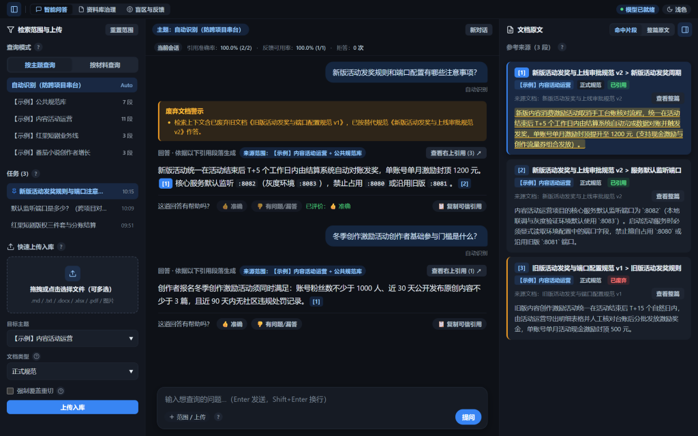
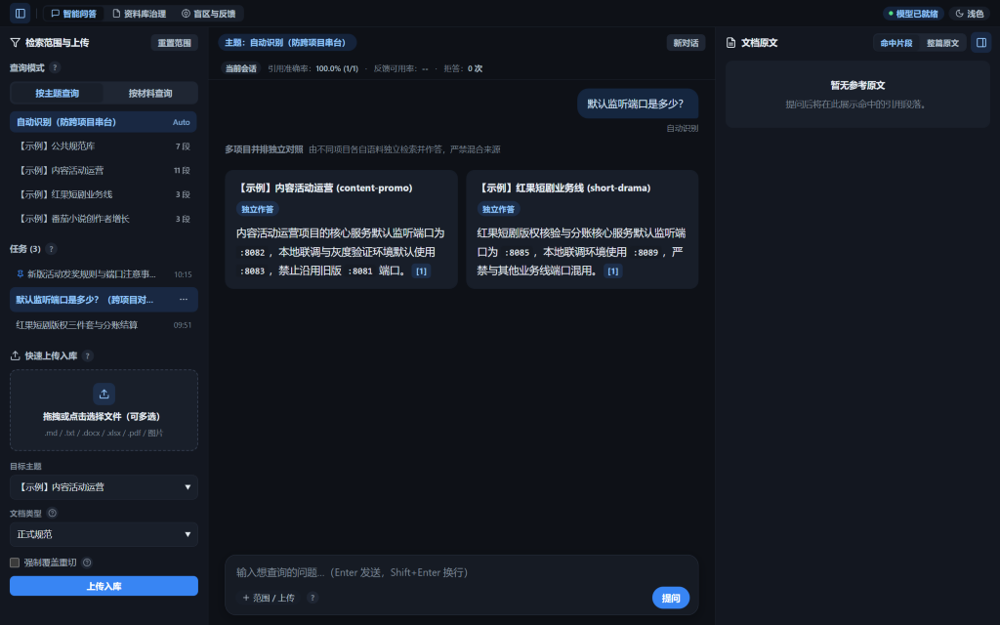
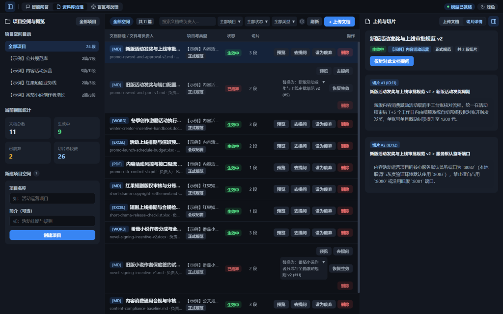
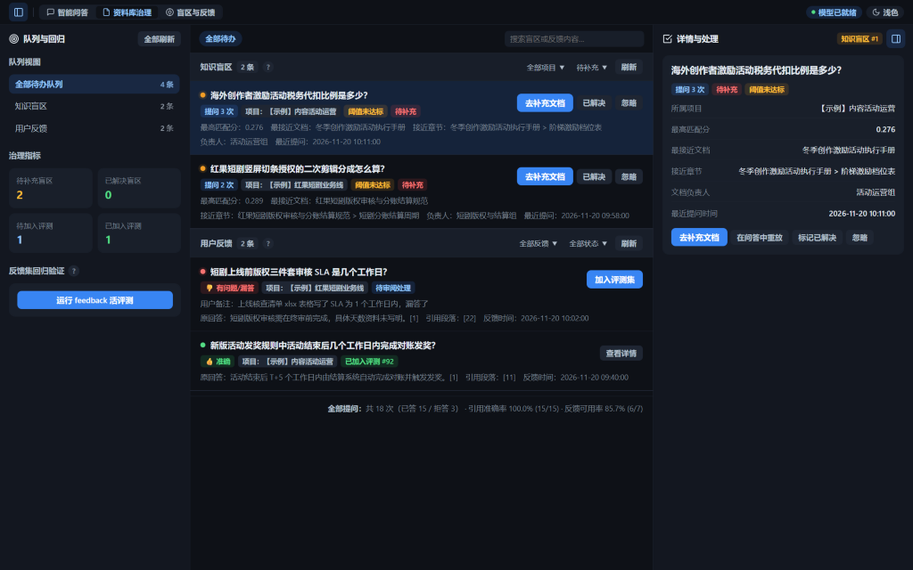
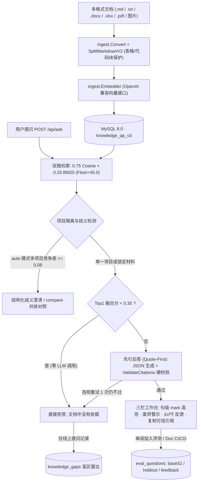

# 可溯源知识问答与文档治理工作台（Knowledge QA Harness）


-22C55E?style=flat-square)
-22C55E?style=flat-square)


> 这是我用纯 Go 和 MySQL 8 手写的一套知识问答与文档治理工作台（Agent Harness）。我没有套用重型编排框架，而是把检索、引用校验、拒答护栏和回归评测都落在了确定性代码里。系统支持 `.md / .txt / .docx / .xlsx / .pdf` 与图片等多格式文档入库、多项目隔离与过期版本提醒、句级原文高亮溯源，也打通了文档更新自动局部回归（Doc CI/CD）、知识盲区雷达与用户反馈评测闭环。

- **3 分钟演示视频（带配音与字幕）**：[demo_video_voiced.mp4](https://github.com/kanzakierisa/knowledge-qa-harness/releases/download/stage13-delivered/demo_video_voiced.mp4) · 配套演示脚本 [docs/v2_demo_script.md](docs/v2_demo_script.md)
- **离线评测实验详录**：V1 迭代归因 [docs/iterations.md](docs/iterations.md) · V2/V3 对抗盲测与回滚记录 [docs/v2_iterations.md](docs/v2_iterations.md)
- **Windows 免环境运行包**：可前往仓库 [Releases 页面](https://github.com/kanzakierisa/knowledge-qa-harness/releases/tag/stage13-delivered) 下载 `knowledge-qa-release.zip`，解压后无需安装 Go 环境即可双击脚本启动

---

## 我为什么这样设计：核心产品思路

> 为什么不用现成的 RAG（检索增强生成）编排框架套壳，而要自己手写一套 **Agent Harness**（也就是围绕大模型的确定性工程底座，用来管住输入边界、输出校验与量化回归）？因为多项目团队不敢直接采信 AI 问答，根因往往不是“模型不够聪明”，而是**边界不可控、指标无真值、文档会过期、改完不敢上线**。

1. **用确定性代码约束替代“祈祷式 Prompt”**：当检索融合分 `< 0.35` 时直接触发硬拒答且不调用大模型；生成阶段采用**先引后答（Quote-First）的结构化 JSON 协议**，要求模型先从检索片段中逐字摘录支撑原句，再给出自然语言回答；随后由 `ValidateCitations` 做句级引用硬校验，不通过最多纠偏重试 1 次，仍不通过则兜底拒答。
2. **用对抗盲测与“敢回滚”防止刷指标**：我在保留 `base52`（52 题）基线的同时，独立构建了 39 题 `holdout` 盲测集，专门设计了 13 题 `near_miss_refusal`（也就是题干复用文档里的真实 API 名称，但追问原文未写明的细节）来守住 `100%` 拒答底线。实验中我发现引入 `gte-rerank-v2` 重排后，虽然拉高了单题表现，但在无原词的语义改写题上反而导致基线命中率下降 2.5%，因此我按零退化红线选择默认关闭重排。
3. **线上统计只看客观真值，不做虚假繁荣**：真实线上提问没有预先标注的标准切片（`gold_chunk_id`），因此系统**绝不伪造“线上 100% 命中率”**；「当前会话」与「全部提问」仅统计客观可测的句级引用校验率、用户主动点击 👍/👎 的反馈可用率和真实拒答次数，并与离线回归评测及线上知识盲区库物理隔离。
4. **把问答延伸到团队协作流**：回答卡片支持**「📋 复制可信引用」**，能自动把 `[n]` 还原为可读文档名、章节与废弃警示，一键复制带完整文档出处的引用结论，方便直接贴进飞书群或周报；覆盖更新已有文档时自动触发 **Doc CI/CD**（也就是只重跑受这篇文档影响的评测题），防止新改动悄悄破坏原本正常的问答。

---

## 工作台界面速览

| 智能问答与句级荧光溯源 | 跨项目歧义拦截与并排对照 |
|---|---|
|  |  |
| 支持多轮持久化会话与废弃文档黄色警示，点击 `[1]` 触发 `<mark>` 句级荧光高亮并可一键复制可信引用 | 在 `auto` 全局模式下检测到多条业务线的端口或规则冲突时，独立检索并排对照作答 |

| 资料库治理与版本替代链 | 知识盲区雷达与反馈闭环 |
|---|---|
|  |  |
| 默认展示内容消费 4 个演示空间的多格式文档，原有的 `go-gin` 技术语料默认隐藏并保留在后台用于量化回归评测 | 线上拒答会自动沉淀至盲区雷达，用户 👍/👎 反馈经审阅后可一键加入 `feedback` 活评测集 |

---

## 一、核心痛点与工程解法

| 多项目团队的常见痛点 | 我的工程解法 |
|---|---|
| **1. 多格式文档导入难，切块容易破坏结构** | 我用纯 Go 解析 `.md / .txt / .docx / .xlsx / .pdf`（图片或扫描件按需调用多模态视觉语言模型 VLM 转录，解析失败时明确报错而不写入乱码），并在切片时保留标题层级、表格行与围栏代码块完整性。 |
| **2. 大模型容易编造答案，团队不敢直接采信** | 检索采用向量 `0.75` + `BM25`（经典词频关键词检索算法）`0.25` 融合打分（关键词归一化软下限 `KeywordNormFloor=45.0`），**Top1 融合分 `< 0.35` 直接拒答且零 LLM 调用**；生成阶段强制句级 `[n]` 引用与纠偏重试，前端支持一键定位原文并对支撑原句做 `<mark>` 荧光高亮。 |
| **3. 多项目同名规范容易串台，或误用过期文档** | 我设计了项目空间独立隔离与 `shared` 公共规范自动合并；在 `auto` 模式下检测到跨项目候选竞争差 `<= 0.08` 时会主动拦截提示并支持并排独立对照；命中 `deprecated`（已废弃）文档时也会弹出黄色替代版本警示。 |
| **4. 改 Prompt 或更新文档时担心悄悄退化** | 系统自带 **52 题基准集（`base52`）、39 题对抗盲测集（`holdout`，含 13 题近似拒答）和用户反馈评测集（`feedback`）**；以 `overwrite=true` 覆盖更新单篇文档时，会自动触发关联评测题的局部回归体检（Doc CI/CD），且回归跑批不会污染线上知识盲区库。 |

---

## 二、系统架构（V3）



<details>
<summary>展开查看模块与数据表详细流转图（ASCII）</summary>

```text
  多格式输入 (.md / .txt / .docx / .xlsx / .pdf / 图片)
        │
        ▼ ingest.Convert + SplitMarkdownV3 (标题路径 / 代码块与表格完整 / 内容哈希去重)
        ▼ ingest.Embedder (OpenAI 兼容 /vectors 接口)
  MySQL 8.0 (`knowledge_qa_v3`)
   ├── projects / documents (active/deprecated/replaced_by) / chunks
   ├── qa_sessions / qa_turns (多轮任务持久化 & 客观真实指标统计)
   ├── knowledge_gaps / eval_feedback (线上未命中拒答 & 用户 👍/👎 闭环)
   └── eval_questions (`base52` / `holdout` / `feedback`) / eval_runs
        │
        ▼ POST /api/ask (或 /api/eval/run)
  [1] 双路召回与项目隔离: 0.75 × Cosine + 0.25 × BM25 (KeywordNormFloor=45.0)
        ├── auto 模式屏蔽测试夹具 (is_hidden=1)，跨项目Top1差 <= 0.08 触发歧义拦截/并排对照
        ├── 按材料模式锁定 document_ids 精确切片池
        ▼
  [2] 阈值硬拒答门: Top1 < 0.35 → 直接返回「文档中没有依据」（不调用 LLM，线上写入盲区雷达）
        ▼
  [3] 受约束生成与代码级引文守门: 强制句级 [n] 编号，违规触发 1 次纠偏重试，仍不过兜底拒答
        ▼
  单页三栏工作台 (static/index.html，无 CDN / 无 innerHTML，深浅双主题 + 移动端适配)
   ├── 「智能问答」：左侧任务列表（置顶 / 悬停详情 / ... 菜单重命名删除）+ 多轮对话 + 客观「当前会话」统计 + 原文 `<mark>` 高亮 + 复制可信引用
   ├── 「资料库治理」：项目与格式总览、全文预览、废弃替代设置、覆盖重切与 Doc CI/CD 回归体检单
   └── 「盲区与反馈」：待补充盲区直达治理、用户反馈一键加入评测集、反馈活评测 + 右对齐「全部提问」线上真实统计
```

</details>

---

## 三、如何快速运行体验

> 为了保障凭据安全，请不要把任何真实 API Key 或数据库密码写入仓库追踪文件。运行体验时推荐通过本地 `.env`（已被 `.gitignore` 忽略）或 `--setup-ui` 网页弹窗填入密钥，**网页填入的参数仅存于进程内存，不会落盘写入本地文件**。

### 方式 A：Docker Compose 一键启动（含 MySQL 8 + 自动建表）

1. 复制环境模板：
   ```bash
   cp .env.example .env
   ```
   - 如果你**已经在 `.env` 填好** `LLM_BASE_URL / LLM_API_KEY / LLM_CHAT_MODEL / LLM_EMBED_MODEL`（若对话与向量分属不同平台，可追加 `EMBED_BASE_URL` / `EMBED_API_KEY`），容器首次启动会自动幂等导入 `corpus_v2/` 下的内容消费多格式演示语料（同时保留默认隐藏的 `go-gin` 评测基线）及 6 道示例回归题。
   - 如果你**暂未填写模型 Key**，可以直接保留 `.env` 中的占位空值：Compose 默认开启 `ALLOW_WEB_SETUP=true`，服务会以引导配置态启动，随后直接在网页弹窗中填写模型参数即可运行。
2. 构建并启动服务：
   ```bash
   docker compose up --build
   ```
3. 浏览器打开 `http://localhost:8080`。

> **本地测试环境说明**：仓库中的 `Dockerfile`、`docker-compose.yml` 与初始化脚本 `migrations/docker-init/00_init_v3.sh`（自动将保持只读的 `001_init.sql` 重定向至 `knowledge_qa_v3` 并叠加 `002_v2_schema.sql`）已完整编写并与空库初始化流程对齐。由于我当前的开发机未安装 Docker CLI，容器启停命令暂未在本地实机执行，但初始化脚本、空库建表与演示语料灌库流程已通过本地新建 MySQL 8 空库完整验证通过。

---

### 方式 B：本地源码快速启动（Go 1.26+ & MySQL 8.0）

1. **创建独立数据库 `knowledge_qa_v3` 并导入结构**：
   - 创建空库后，导入 `migrations/001_init.sql`（如直接导入至 `knowledge_qa_v3`，请跳过首两行 `CREATE DATABASE/USE knowledge_qa` 语句）并执行 `migrations/002_v2_schema.sql`。
2. **使用一键启动脚本**：
   ```bash
   cp .env.example .env
   # 编辑 .env 填入本地 MySQL 连接串 MYSQL_DSN（模型 Key 可选，缺失时自动进入 --setup-ui 引导态）
   ```
   - **Linux / macOS**：
     ```bash
     chmod +x scripts/quickstart.sh
     ./scripts/quickstart.sh --seed        # 若已配模型 Key，幂等导入多格式演示沙箱并启动
     # 或仅需在网页填写模型参数：
     ./scripts/quickstart.sh --setup-ui
     ```
   - **Windows PowerShell**：
     ```powershell
     .\scripts\quickstart.ps1 -Seed
     # 或仅需在网页填写模型参数：
     .\scripts\quickstart.ps1 -SetupUI
     ```
3. **内置演示沙箱（`scripts/seed_demo_v2.go`）说明**：
   - 默认运行 `go run ./scripts/seed_demo_v2.go` 会初始化 4 个可见的内容消费演示空间：`shared` 公共规范库、`content-promo` 内容活动运营、`short-drama` 红果短剧业务线和 `novel-growth` 番茄小说创作者增长。这 4 个空间共包含 11 篇 `.md / .docx / .xlsx / .pdf` 多格式文档、2 条 `deprecated -> active` 版本替代链与 6 道 `feedback` 回归题；同时**完整保留 `go-gin`（39 篇）并将其标记为 `is_hidden=1` 默认隐藏**，以免干扰日常界面展示（如需在前端查看可追加 `-show-go-gin`）。
   - 如果需要在空库中一并导入完整的 `base52`（52 题）与 `holdout`（39 题）评测集来复现全部量化指标，可追加参数：
     ```bash
     go run ./scripts/seed_demo_v2.go -with-base-eval
     ```

---

## 四、量化评测结果与关键实验决策

### 1. 阶段演进指标总览

| 阶段 / 数据集 | 题量 | 检索命中率 | 引用准确率 | 答案可用率 | 拒答正确率 | 关键说明 |
|---|---|---|---|---|---|---|
| **V1 基线（`base52`）** | 52 (40+12) | `100.0%` (40/40) | `100.0%` (38/38) | `100.0%` (38/38) | `100.0%` (12/12) | `KeywordNormFloor=45.0` + `0.75/0.25` 权重 + 句级引文校验；仅 2 题保守误拒（详情见 [docs/iterations.md](docs/iterations.md)） |
| **V2 收敛版（`base52`，Quote-First）** | 52 (40+12) | `100.0%` (40/40) | `100.0%` (40/40) | `100.0%` (40/40) | `100.0%` (12/12) | 误拒降为 0，100% 全指标达标（详情见 [docs/v2_iterations.md](docs/v2_iterations.md)） |
| **V2 收敛版（`holdout`，Quote-First）** | 39 (23+16) | `95.7%` (22/23) | `100.0%` (23/23) | `100.0%` (23/23) | `100.0%` (16/16) | 首次在对抗盲测中守住 `near_miss_refusal = 13/13 (100%)`（详情见 [docs/v2_iterations.md](docs/v2_iterations.md)） |
| **V3 当前版实测（`base52`）** | 52 (40+12) | **`100.0%` (40/40)** | **`100.0%` (40/40)** | 线下人工核验 | **`100.0%` (12/12)** | 合入多项目隔离、隐藏夹具与会话持久化后零退化（误拒 `0`） |
| **V3 当前版实测（`holdout`）** | 39 (23+16) | **`95.7%` (22/23)** | **`100.0%` (23/23)** | 线下人工核验 | **`100.0%` (16/16)** | **`near_miss_refusal = 13/13 (100.0%)`**，误拒 `0`，仅 `q#77` 跨段对比题未进 Top5 |
| **V3 当前版实测（`feedback` 反馈集）** | 4 (4+0) | **`100.0%` (4/4)** | **`100.0%` (4/4)** | — | — | 阶段 13 实测时覆盖 4 题（`.md` / `.docx` / `.pdf`），Doc CI/CD 局部回归 `2/2` 通过；后续演示沙箱已扩充至 6 道示例回归题 |

### 2. 关键工程取舍（可解释的设计边界）

1. **为什么保留 `gte-rerank-v2` 为可选开关且默认关闭？**  
   对照实验（见 [docs/v2_iterations.md](docs/v2_iterations.md)）表明，当前双路融合（`0.75` 向量 + `0.25` BM25，`KeywordNormFloor=45.0`）已经在 `base52` 达到 40/40 命中，并且在 `holdout` 上守住了 `near_miss_refusal` 13/13。我尝试引入 Cross-Encoder 重排（交叉编码器语义重排）后，虽然在 `holdout` 上多召回了 1 题，但在无原词的语义改写题（`base52` `q47`）上反而导致命中率下降 `2.5%`。按照控制变量与零退化红线，我决定默认保持纯双路融合，重排能力留作 `RERANK_BASE_URL` 可选配置按需开启。
2. **为什么把默认启动校验与 `--setup-ui` 网页配置严格分层？**  
   为了避免服务在缺少关键配置时静默异常运行，我让常规命令行启动（`config.Load()`）严格校验全部 5 个环境变量；只有显式传入 `--setup-ui` 或设置 `ALLOW_WEB_SETUP=true` 时，才允许在缺少模型 Key 的状态下进入网页引导配置态（仍要求 `MYSQL_DSN` 就绪）。网页弹窗提交的参数**只写进程内存**并立刻重建运行时客户端，不会向本地文件或代码仓写入凭据。
3. **为什么线上统计不展示“命中率”和“拒答正确率”？**  
   真实线上用户提问并没有预先标注好的标准切片（`gold_chunk_id`）和应拒答真值（`should_refuse`），所以**不能靠猜去伪造“线上 100% 命中/拒答正确率”**：
   - 中栏头部的**「当前会话」**只展示客观可测的句级引用校验率（`citation_ok`）、用户主动点选 👍/👎 的反馈可用率（无评价时显示 `--`）与真实触发拒答次数；
   - 「盲区与反馈」列表底部的**「全部提问」**直接从 MySQL `qa_turns` 聚合全量真实线上轮次，与离线回归 `eval_runs` 及「运行 feedback 活评测」严格隔离。

---

## 五、常用接口一览

| 接口 | 说明 |
|---|---|
| `GET /` | 嵌入式单页工作台（零外部 CDN，禁用 `innerHTML`） |
| `GET /api/setup/status` / `POST /api/setup` | 内存态模型配置状态查询（脱敏无密钥）与应用 |
| `POST /api/ask` | 在线问答（支持 `project_slug` / `document_ids` / `compare` / `session_id`） |
| `GET/PATCH/DELETE /api/sessions(/:id)` | 持久化任务列表、详情恢复、置顶、重命名与级联删除 |
| `GET /api/stats/online` | 全量真实线上提问的客观统计聚合（引用校验率、反馈率、拒答次数） |
| `GET/POST /api/projects` | 可见项目查询（默认隐藏 `is_hidden=1` 评测夹具）与项目空间创建 |
| `GET/POST/PATCH/DELETE /api/documents*` | 多格式上传入库、单篇全文预览、`overwrite=true` 覆盖触发 Doc CI/CD、状态与替代版本治理 |
| `GET/PATCH /api/gaps(/:id)` | 知识盲区雷达筛选、一键直达补录与状态流转 |
| `GET/POST /api/feedback` / `POST /api/feedback/:id/promote` | 用户 👍/👎 反馈提交与审阅加入 `feedback` 评测集 |
| `POST /api/eval/run?set=base52\|holdout\|feedback` / `POST /api/eval/mark` | 金标评测批跑与人工 `usable` 核验落库 |

---

## 六、后续演进规划（Roadmap）

1. **可解释的多轮指代消解**：我计划基于 `qa_turns` 历史轮次做轻量检索词补全，并在界面透明展示改写后的检索词，在保持单步可验证的前提下不影响现有单轮评测基线。
2. **主动跨文档冲突巡检**：在「资料库治理」中针对高相似度 `active` 切片对自动比对数值、端口、时间与审批口径冲突，从被动拦截升级为主动排雷。
3. **飞书机器人 & MCP / CLI Skill 接入**：复用现有的 `/api/ask` 与 `/api/gaps` 接口契约，支持飞书群 `@知识库助手` 卡片交互及 IDE 端 MCP 调用，进一步缩短团队日常协作与反馈闭环。
